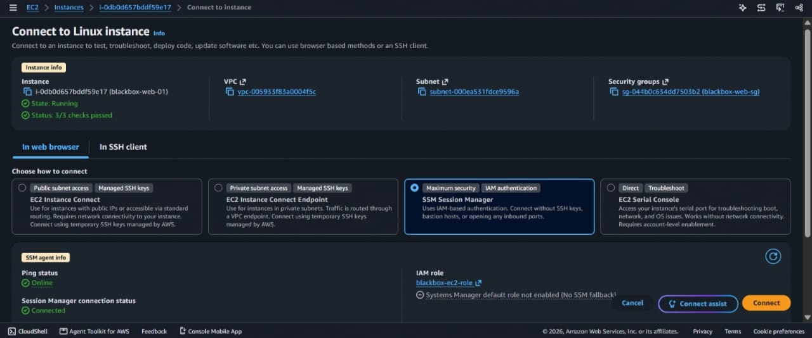
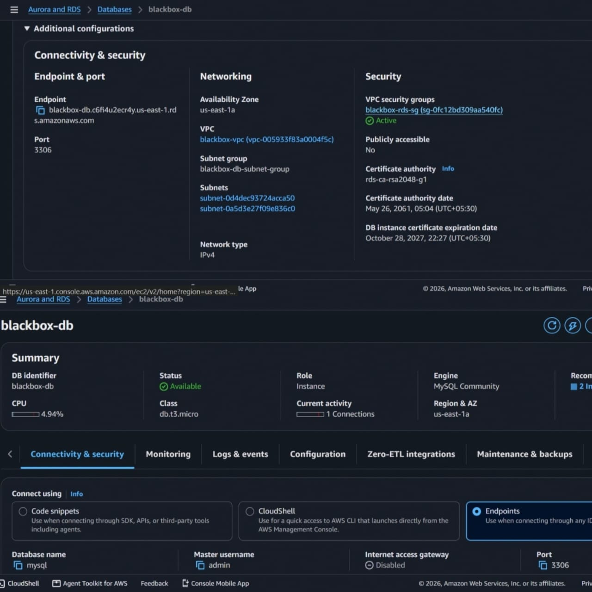
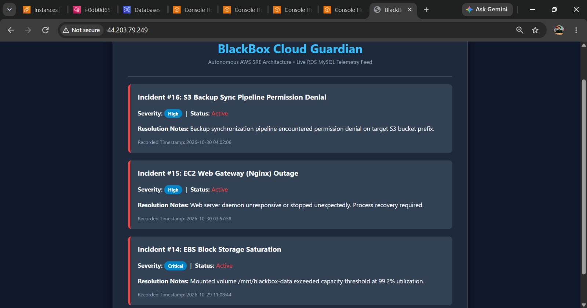
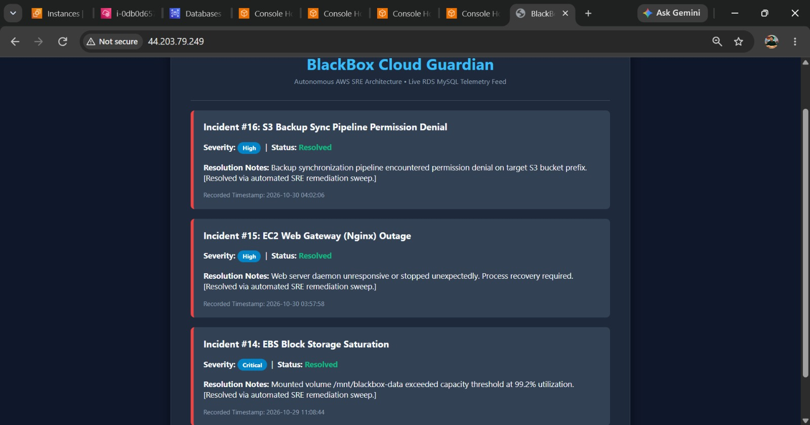
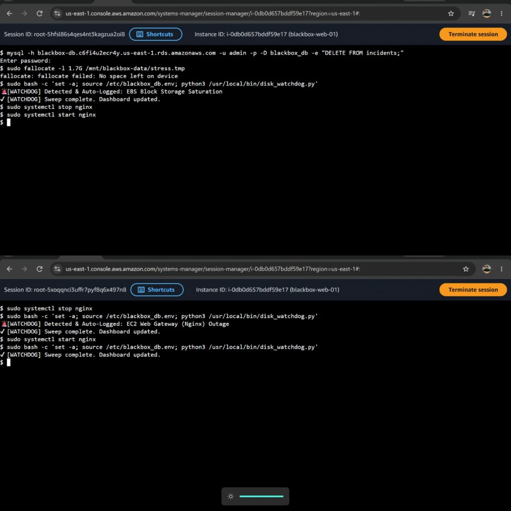
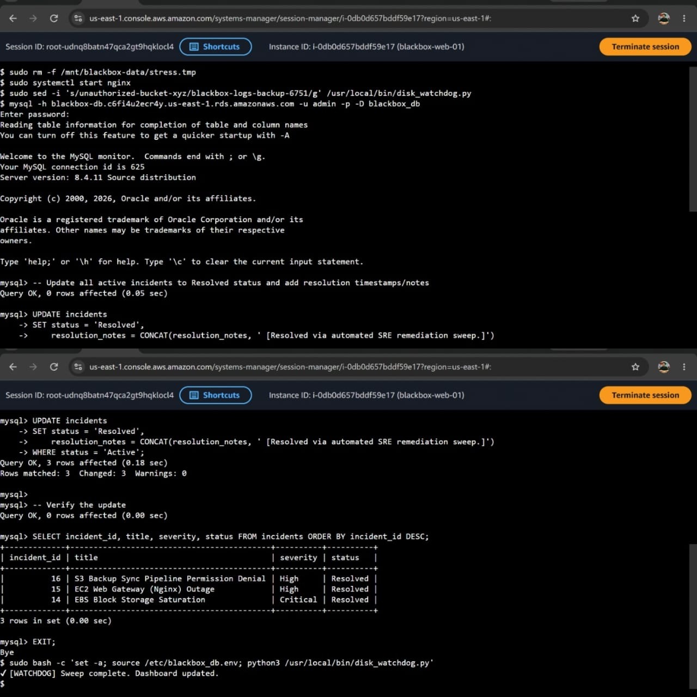
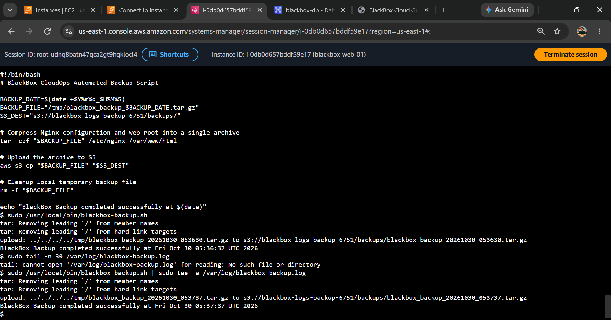
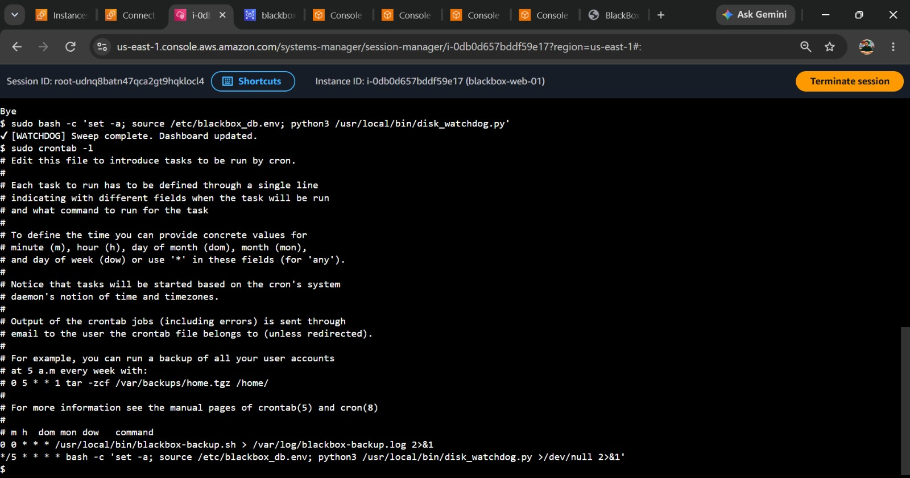
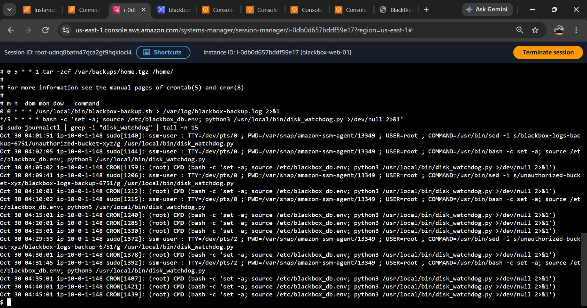

# BlackBox Cloud Guardian

**BlackBox Cloud Guardian** is an enterprise-grade AWS SRE operations and telemetry platform designed for tracking infrastructure incidents, automating health watchdogs, and managing automated disaster recovery pipelines.

---

## Architecture Overview

```text
+-----------------------------------------------------------------------+
|                           AWS Cloud (Custom VPC)                      |
|                                                                       |
|   +-------------------------------+         +---------------------+   |
|   |         Public Subnet         |         |    Private Subnet   |   |
|   |                               |         |                     |   |
|   |    +---------------------+    |         |   +-------------+   |   |
|   |    |  EC2 Web Instance   |    |         |   | Amazon RDS  |   |   |
|   |    |  (Nginx & Watchdog) |    |         |   |    MySQL    |   |   |
|   |    +----------+----------+    |         |   +------^------+   |   |
|   |               |               |         |          |          |   |
|   |               v               |         |   (Incident Data)   |   |
|   |    +---------------------+    |         +---------------------+   |
|   |    |     EBS Volume      |    |                    ^              |
|   |    |  (/mnt/blackbox)    |    |                    |              |
|   |    +----------+----------+    |                    |              |
|   +---------------|---------------+--------------------+--------------+
|                   | (Automated Backup Script & IAM Role Authentication)
+-------------------|---------------------------------------------------+
                    v
+-----------------------------------------------------------------------+
|                        Amazon S3 Backup Bucket                        |
+-----------------------------------------------------------------------+
Key Architectural Components
Custom VPC (screenshots/VPC.jpeg): Enforces strict network isolation, separating the public web gateway subnet from the private database subnet tier.

EC2 Web Gateway (screenshots/EC2.jpeg): Hosts Nginx and the dashboard application, managed securely via AWS Systems Manager Session Manager (blackbox-ec2-role).

EBS Storage (screenshots/Commands.jpeg): Block storage mounted at /mnt/blackbox-data for handling application workloads and storage threshold stress testing.

Private Amazon RDS MySQL (screenshots/RDS.jpeg): Isolated database instance on port 3306, accepting traffic strictly from the application security group.

IAM Role Integration: Least-privilege instance profiles providing secure S3 bucket synchronization without storing hardcoded keys.

Operational Workflows & Evidence
1. Telemetry & Active Incidents
The browser dashboard displays live incident states fetched directly from the database, monitoring metrics like EBS storage saturation and service health.

2. Automated S3 Backup Pipeline
Daily and manual backup scripts compress Nginx configuration and web root directories into an archive, pushing them securely to the Amazon S3 backup destination (s3://blackbox-logs-backup-6751/backups/).

3. Watchdog & Recovery Commands
Simulated disk saturation stress tests (fallocate) trigger the Python health watchdog (disk_watchdog.py), which captures system exceptions and auto-logs them as active incidents.

4. Cron Job Automation
Configured system cron jobs orchestrate recurring operational background tasks:

Backups: Scheduled daily at midnight (0 0 * * * /usr/local/bin/blackbox-backup.sh).

Health Watchdog: Executed every 5 minutes (*/5 * * * *).

5. Log Monitoring
Systemd journalctl logs track continuous execution traces of the watchdog and backup jobs to ensure seamless error handling and execution verification.

6. Incident Resolution & SQL Verification
Database queries update incident statuses from Active to Resolved via automated SRE remediation workflows:

SQL
UPDATE incidents 
SET status = 'Resolved', 
    resolution_notes = CONCAT(resolution_notes, ' [Resolved via automated SRE remediation sweep.]') 
WHERE status = 'Active';

SELECT incident_id, title, severity, status 
FROM incidents 
ORDER BY incident_id DESC;
The dashboard immediately reflects these resolved updates.

## System Verification & Proof Gallery

* **VPC Architecture:**
  

* **EC2 & SSM Connection:**
  

* **Private RDS Database:**
  

* **Active Incident Dashboard:**
  

* **Resolved Incident Dashboard:**
  

* **Disk Saturation & Watchdog Commands:**
  

* **Database SQL Verification:**
  

* **S3 Backup Script Execution:**
  

* **Cron Job Scheduler:**
  

* **Systemd Journalctl Logs:**
  


Operations & Troubleshooting Runbook
Dashboard Unreachable: Verify EC2 instance state, Nginx service status (systemctl status nginx), and port security group ingress rules.

Database Connection Failures: Verify RDS endpoint connectivity, check /etc/blackbox_db.env configurations, and review inbound security group ports.

Failed S3 Backup Uploads: Check EC2 IAM role policies, confirm bucket destination paths, and monitor disk space availability.

Security & Best Practices
Zero Public Database Exposure: RDS remains strictly within private subnets.

Credential Hygiene: No long-lived AWS keys are stored on instances; IAM roles manage cloud permissions.

Sanitized Repositories: All account IDs, IP addresses, and private credentials are excluded from version control.

Contributing
Open an issue describing the proposed change or bug fix.

Ensure changes adhere to least-privilege security policies.

Verify all updates in a non-production environment before submitting a pull request.

